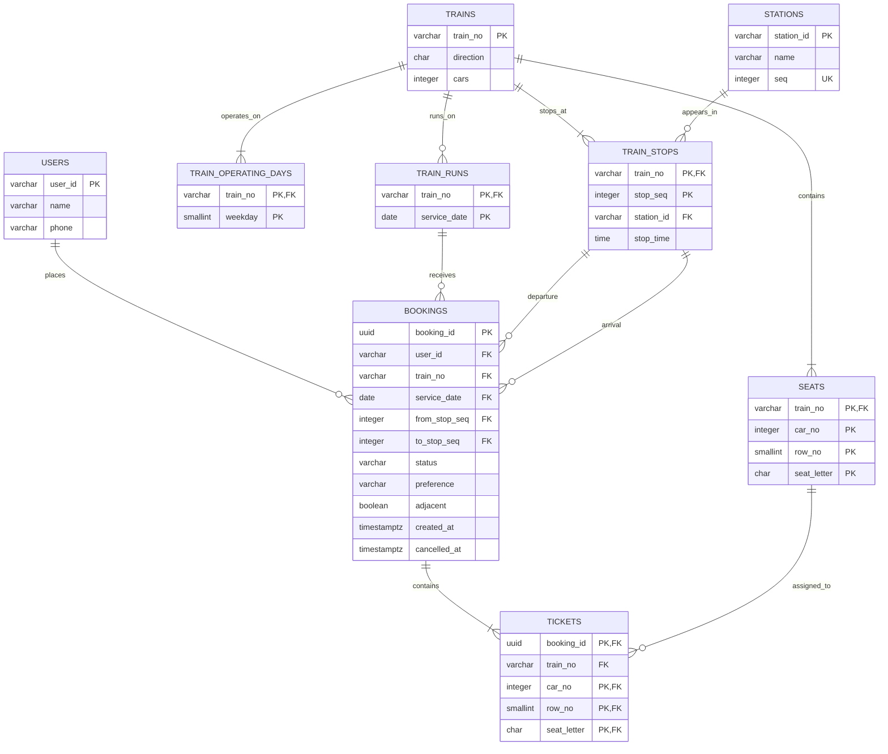

# Mini THSR database design

Version 1 — 4 November 2026

This design supports B1–B6 and A1–A4 using PostgreSQL and handwritten SQL. The initial DDL is now available in ../schema/schema.sql. The schema and 25 constraint rejection cases have passed tests on PostgreSQL 17, together with valid fixtures and cancellation history checks. See ../tests/schema_constraints.sql. The next step is to write the CSV importer; booking API and concurrency behavior remain unimplemented.

## Entities and fields

PK = primary key; FK = foreign key; UQ = unique constraint. Unless marked nullable, fields are NOT NULL.

| Table | Fields and constraints | Meaning |
|---|---|---|
| users | user_id varchar(20) PK; name varchar(50), CHECK nonblank; phone varchar(20) nullable | Users imported from users.csv. No login or password. |
| stations | station_id varchar(10) PK; name varchar(50), CHECK nonblank; seq integer UQ, CHECK > 0 | Stations ordered north to south. |
| trains | train_no varchar(20) PK; direction char(1), CHECK IN ('S','N'); cars integer, CHECK > 0 | A timetable train definition. Train numbers remain strings to preserve leading zeros. |
| train_operating_days | train_no FK to trains; weekday smallint CHECK BETWEEN 1 AND 7; PK (train_no, weekday) | One row per operating weekday; Monday = 1. |
| train_stops | train_no FK to trains; stop_seq integer CHECK > 0; station_id FK to stations; stop_time time, minute precision and below 24:00; PK (train_no, stop_seq); UQ (train_no, station_id) | Stops in this train's travel order, numbered from 1. Empty timetable cells do not create stops. |
| seats | train_no FK to trains; car_no integer CHECK > 0; row_no smallint CHECK BETWEEN 1 AND 4; seat_letter char(1) CHECK IN ('A','B','C','D','E'); PK (train_no, car_no, row_no, seat_letter) | Physical seat positions for each train definition. Generate 20 seats per car. |
| train_runs | train_no FK to trains; service_date date; PK (train_no, service_date); CHECK date BETWEEN 2026-12-01 AND 2027-01-31 | A train operating on a particular date. Also provides a stable row for transaction locking. |
| bookings | booking_id uuid PK; user_id FK to users; train_no; service_date; from_stop_seq integer; to_stop_seq integer; status varchar(10) CHECK IN ('confirmed','cancelled'); preference varchar(6) nullable CHECK IN ('window','aisle'); adjacent boolean DEFAULT false; created_at timestamptz; cancelled_at timestamptz nullable; UQ (booking_id, train_no) | One user's order for one train, date and journey segment. |
| tickets | booking_id; train_no; car_no; row_no; seat_letter; PK (booking_id, car_no, row_no, seat_letter) | One assigned seat within an order. Tickets are retained after cancellation. |

Additional foreign keys and row constraints:

- bookings (train_no, service_date) references train_runs.
- bookings (train_no, from_stop_seq) and (train_no, to_stop_seq) reference train_stops.
- bookings CHECK (from_stop_seq < to_stop_seq).
- bookings CHECK (NOT adjacent OR preference IS NULL).
- bookings CHECK ((status = 'confirmed' AND cancelled_at IS NULL) OR (status = 'cancelled' AND cancelled_at IS NOT NULL)).
- tickets (booking_id, train_no) references bookings (booking_id, train_no).
- tickets (train_no, car_no, row_no, seat_letter) references seats.
- Use restrictive deletion behavior for reference and booking data. Cancellation updates status; it does not delete orders or tickets.

The train_no repeated in tickets is deliberate, constrained redundancy: the two composite foreign keys prevent assigning a seat belonging to another train. Explain this tradeoff in the normalization report; do not claim that this redundancy is eliminated by 3NF.

## Entity relationship diagram



Composite keys are specified in the table and foreign-key list above. The diagram shows intended domain cardinalities: each order contains 1–5 tickets. A foreign key alone does not enforce this minimum or maximum.

## Journey segments and seat reuse

Use train_stops.stop_seq, not stations.seq, for journey comparisons. stations.seq always increases southward; stop_seq increases in the direction of the particular train. For a northbound train, order its nonempty timetable stops by descending stations.seq before assigning stop_seq.

Represent occupancy as a half-open interval [from_stop_seq, to_stop_seq). Two bookings overlap exactly when:

```sql
existing.from_stop_seq < requested.to_stop_seq
AND requested.from_stop_seq < existing.to_stop_seq
```

Only confirmed bookings for the same train, service date and physical seat block availability. For example, intervals [1,4) and [4,6) can share a seat; [1,4) and [3,6) cannot. A seat must be free throughout the entire requested interval. Do not calculate availability by taking the minimum free-seat count across segments: different seats can be occupied on different segments.

## Transaction and locking design

Use a conservative per-run lock for the first implementation. All booking and cancellation operations for a train and date must use the same lock protocol.

1. Validate request types and required fields. Start an explicit transaction.
2. Lock the existing train_runs row using SELECT ... FOR UPDATE for (train_no, service_date).
3. After obtaining the lock, query current confirmed occupancy and validate the journey. Use PostgreSQL READ COMMITTED so these subsequent statements see transactions committed before the lock was acquired.
4. Find the complete required set of seats. If availability, preference or adjacency cannot be satisfied, roll back without creating an order.
5. Insert the booking and every ticket within the same transaction. Commit only after all inserts succeed.
6. For cancellation, acquire the same run lock, recheck the booking owner and current status, update status and cancelled_at, then commit. Retain ticket rows for history.

For cancellation, an initial read may discover the train and date, but ownership and status must be rechecked after acquiring the lock. Do not lock a booking before the run; maintain the same lock order everywhere.

This serializes writes for the same train and date, including nonoverlapping journeys. It is a simple correctness-first tradeoff suitable for this project. Different train runs can be booked concurrently. The schema alone does not prevent overlapping tickets inserted outside this protocol; all reservation writes must follow it.

## Stored and derived values

- Derive seat_count from the number of ticket rows, including for cancelled orders. Enforce 1–5 tickets, single-ticket preference and multi-ticket adjacency in the booking service transaction.
- Derive the API seat_id from car_no, row_no and seat_letter, for example 2-3A. It is not globally unique across trains.
- Derive station IDs and times through train_stops; do not duplicate station names or timetable times in bookings.
- Derive availability from confirmed bookings; do not store an is_available flag or a mutable remaining-seat counter.
- For window use A/E; for aisle use C/D. Adjacent means consecutive letters in ABCDE within one car and row.
- Derive preference_met and adjacent_met when applicable from assigned seats according to the API contract.

## Import and validation responsibilities

Import users and stations first. Parse timetable.csv into trains, operating days and stops. Resolve station columns from the imported station IDs rather than hard-coding the public dataset. Preserve leading zeros in train numbers. Generate seats from cars and runs from weekdays over the required operating period.

Validate cross-table conditions in the importer: each car_no must be within trains.cars, each run must match an operating weekday, stop numbering must be consecutive, and times must increase in travel order. Ordinary PostgreSQL CHECK constraints cannot query other tables. Generate the complete dataset in one explicit initialization transaction.

## Initial index plan

Primary and unique constraints create their supporting indexes. Add:

- bookings (user_id, created_at, booking_id) for user history.
- A partial index on bookings (train_no, service_date, from_stop_seq, to_stop_seq) WHERE status = 'confirmed' for occupancy queries.
- train_stops (station_id, train_no) for finding trains serving the requested stations.

The ticket primary key supports retrieving seats by booking. Evaluate query plans and realistic test data before adding additional indexes.

## Design checks before implementation

- Southbound and northbound journeys use increasing train stop positions.
- The same seat can be reused on adjacent intervals and on different dates.
- Overlapping confirmed tickets cannot be created by concurrent application requests.
- With 4 seats left, two simultaneous orders for 3 seats produce exactly one success.
- A failed multi-ticket order leaves no booking or ticket records.
- Cancellation preserves history and frees the segment after commit.
- Normal restarts preserve bookings; resetting the database is a separate explicit action.

Review basis: https://github.com/Emmypl/db-mini-thsr at commit d34dfd1 and the Mini THSR specification supplied in the conversation. This schema does not implement the remaining API endpoints or timetable import.
